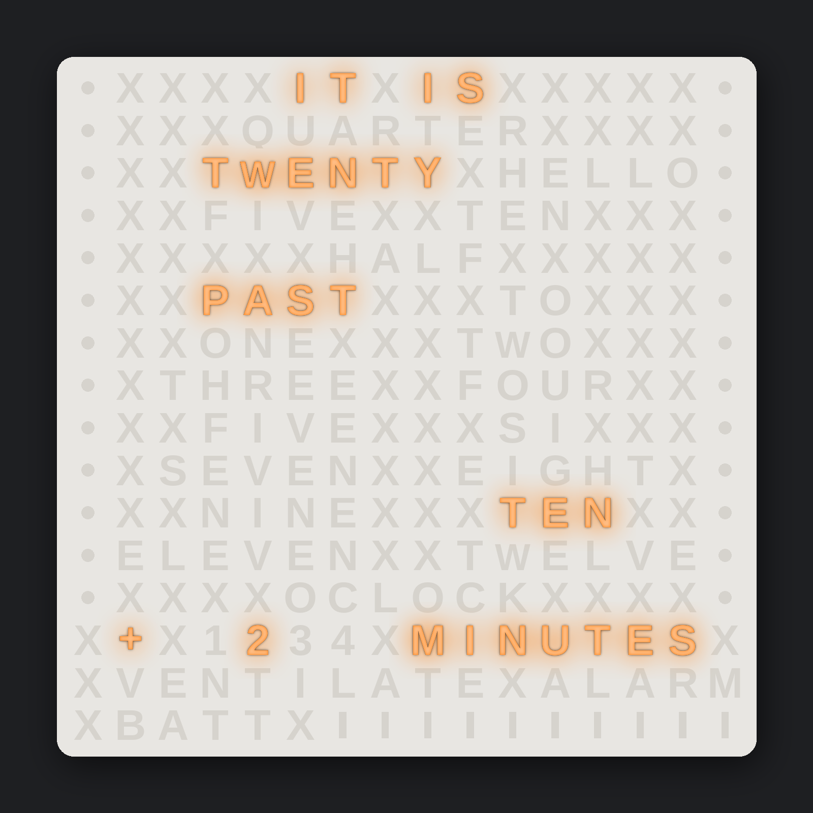
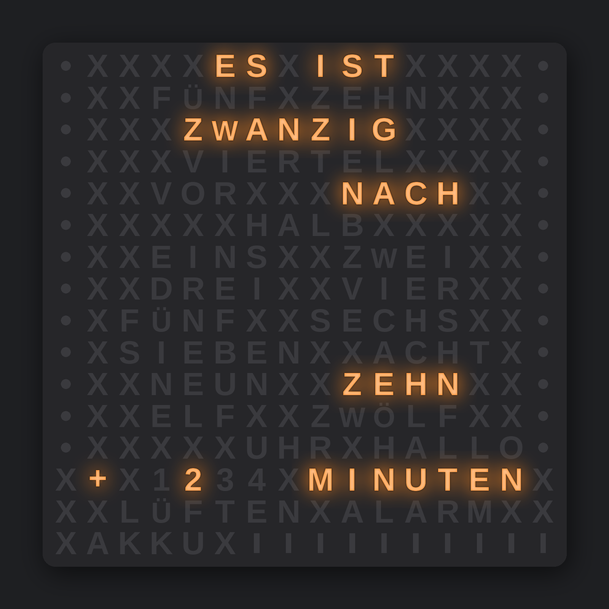
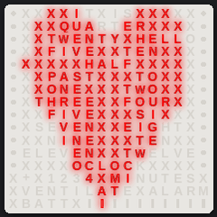
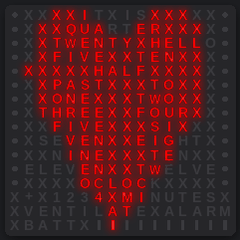
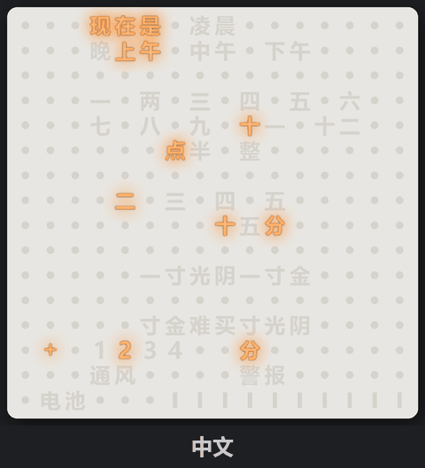
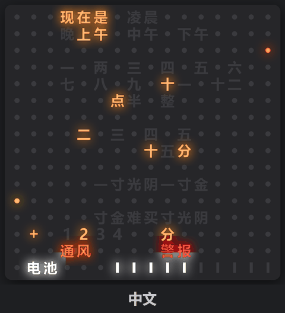

# Wordclock_Multi - 16x16 word clock in many languages

A word clock on a 16 x 16 LED matrix (WS2812, 16 x 16 cm) with an ESP32. One code base for 31 languages and
dialects: logic, effects and the case exist only once, every language is a set of three small files.
Runs either with **ESPHome / Home Assistant** or stand-alone as an **Arduino** sketch with its own web interface.

Deutsche Fassung: [README_DE.md](README_DE.md)

<p align="center">
  
  
</p>

3D model (case, front per language, stand, wall and Skadis holders, picture frame version):
**MakerWorld:** _link follows_ <!-- MAKERWORLD_LINK -->
The models are not part of this repository.

Version 1.0. Model, print and firmware are tested for all languages. Grammar and spelling confirmed (v1.0): DE (Deutsch),
GB (English), PL (Polski) and the dialects dialect_BAD (Badisch), dialect_CH (Schwizerdütsch) and dialect_SWG (Schwäbisch). All other
languages are v0.9 (grammar unconfirmed) until native speakers have confirmed grammar and spelling.
Corrections are very welcome (issue or pull request).

## Features

- Time in words with single minutes (`+ 1..4 MINUTES`), colours per display element (palette, random every hour,
  own colour; time words also "Pride": one random colour per word, new every minute)
- Temperature dots outside (left column) and inside (right column), VENT and ALARM words, battery bars – each can
  be switched off with the colour option "Off"
- Brightness day/night, night by sun position, fixed times or mixed (sun, but not before / not after a time)
- Effects: rainbow, aurora, matrix, fire, confetti, stars, blink (duration and blink cycle adjustable)
- Text ticker: a text runs letter by letter over the whole matrix (Latin, Greek, Cyrillic, digits, € and ♥)
- Easter egg per language (greeting or typical saying from free cells), switchable; shown at the start until the
  time is known (pulsing blue while the hotspot is open)
- Current limit, LED wiring (zigzag / row by row, mirrored) adjustable
- Arduino: web interface in the language of the clock (switchable to English), hotspot with captive portal for the first start,
  NTP via DHCP, outdoor temperature from Open-Meteo (optional), HTTP API
- ESPHome: all settings as Home Assistant entities, sensors from Home Assistant by entity ID

<p align="center"> </p>

## Languages

Order: languages of countries, dialects, other languages. Grids, grammar and example times of every language:
`docs/languages/LANG_<code>.txt`, overview `docs/languages/LANGUAGES.txt`. A new language: [LANG_SPEC.md](docs/LANG_SPEC.md).

<!-- LANGUAGES BEGIN (table written by tools/make_info.py) -->
| Code | Language | Kind | Version | Default location |
|---|---|---|---|---|
| `DE` | Deutsch | country | v1.0 confirmed | Berlin |
| `GB` | English | country | v1.0 confirmed | London |
| `CN` | 中文 | country | v0.9 grammar unconfirmed | Beijing |
| `CZ` | Čeština | country | v0.9 grammar unconfirmed | Praha |
| `DK` | Dansk | country | v0.9 grammar unconfirmed | København |
| `ES` | Español | country | v0.9 grammar unconfirmed | Madrid |
| `FR` | Français | country | v0.9 grammar unconfirmed | Paris |
| `GR` | Ελληνικά | country | v0.9 grammar unconfirmed | Athína |
| `HU` | Magyar | country | v0.9 grammar unconfirmed | Budapest |
| `ID` | Bahasa Indonesia | country | v0.9 grammar unconfirmed | Jakarta |
| `IT` | Italiano | country | v0.9 grammar unconfirmed | Roma |
| `JP` | 日本語 | country | v0.9 grammar unconfirmed | Tokyo |
| `KR` | 한국어 | country | v0.9 grammar unconfirmed | Seoul |
| `NL` | Nederlands | country | v0.9 grammar unconfirmed | Amsterdam |
| `NO` | Norsk | country | v0.9 grammar unconfirmed | Oslo |
| `PL` | Polski | country | v1.0 confirmed | Warszawa |
| `PT` | Português | country | v0.9 grammar unconfirmed | Lisboa |
| `RO` | Română | country | v0.9 grammar unconfirmed | București |
| `SE` | Svenska | country | v0.9 grammar unconfirmed | Stockholm |
| `TR` | Türkçe | country | v0.9 grammar unconfirmed | Ankara |
| `TZ` | Kiswahili | country | v0.9 grammar unconfirmed | Dodoma |
| `UA` | Українська | country | v0.9 grammar unconfirmed | Київ (Kyiv) |
| `dialect_BAD` | Badisch | dialect | v1.0 confirmed | Freiburg im Breisgau |
| `dialect_CH` | Schwizerdütsch | dialect | v1.0 confirmed | Bern |
| `dialect_SWG` | Schwäbisch | dialect | v1.0 confirmed | Stuttgart |
| `EO` | Esperanto | other | v0.9 grammar unconfirmed | Warszawa |
| `VA` | Latina | other | v0.9 grammar unconfirmed | Città del Vaticano |
| `scifi_HVA` | Valyrio | other | v0.9 grammar unconfirmed | Roma |
| `scifi_NAV` | Na'vi | other | v0.9 grammar unconfirmed | Berlin |
| `scifi_QYA` | Quenya | other | v0.9 grammar unconfirmed | London |
| `scifi_TLH` | tlhIngan Hol | other | v0.9 grammar unconfirmed | Berlin |
| `scifi_RUNE_DE` | Runen (Deutsch) | script variant of `DE` (front only) | firmware of `DE` | Berlin |
| `scifi_RUNE_GB` | Runes (English) | script variant of `GB` (front only) | firmware of `GB` | London |
<!-- LANGUAGES END -->

<p align="center"> </p>

## Quick start

| Variant | Copy | Choose the language | Guide |
|---|---|---|---|
| Arduino | folder `arduino/Wordclock` into the sketchbook | `config.h`: `#define WC_LANG_FILE "src/wc_lang_GB.h"` | [`arduino/README.md`](arduino/README.md) |
| ESPHome | content of `esphome/` to `/config/esphome/` | `wordclock_multi.yaml`: `lang: !include wordclock_multi/lang/lang_GB.yaml` | [`esphome/README.md`](esphome/README.md) |

Both base files list all languages as ready-to-copy lines in a comment.
Even simpler: single-file versions per language in `arduino/single_Language/` and `esphome/single_Language/`
(each folder has a README.md).

### ESPHome

Secrets in `secrets.yaml`: `wifi_ssid`, `wifi_password`, `ap_password`, `api_key`, `ota_password`.
Copy the content of `esphome/` 1:1 to `/config/esphome/` (`wordclock_multi.yaml` plus the folder `wordclock_multi/`;
the subfolder keeps the packages out of the dashboard device list; `single_Language/` is not needed). In `wordclock_multi.yaml` set the language,
the data pin and the Home Assistant entities for alarm, vent, battery and the two temperatures.
Defaults: Wemos D1 mini ESP32, GPIO32, zigzag wiring; ESP32-C6 see the comment at the end of the file.
Device name: `name` / `friendly_name` under `substitutions:` in `wordclock_multi.yaml`. Several clocks: one copy of
`wordclock_multi.yaml` per clock (e.g. `wordclock-kitchen.yaml`) with its own `name`, all share `wordclock_multi/`;
renaming in the ESPHome dashboard (Rename) works too.

- Effects: select "Effect" and "Effect colour", then press "Start effect".
- Text ticker: text entity "Text ticker" and button "Start text" (names in the language of the clock), or in an
  automation the action `esphome.<name>_show_text` with `text: "Happy birthday"`.

### Arduino

ESP32 board package 2.0.x or 3.x by Espressif (with 2.0.x additionally "Adafruit NeoPixel"). Open
`arduino/Wordclock`, choose the language in `config.h`, upload via USB
(partition scheme "Default 4MB with spiffs"; no firmware update over Wi-Fi). First start: the clock opens a hotspot
(e.g. "Wordclock"), connect and open http://192.168.4.1, enter your Wi-Fi. Afterwards the clock is reachable at
http://wordclock.local (name per language) or its IP address.

HTTP API (parameter names are the same in all languages, full list at the top of `Wordclock.ino`):

```
/api/set?tout=8.5&tin=21.5&akku=80&luft=1&alarm=0      measured values
/api/set?brday=40&col_time=random&show_minutes=1       settings (saved)
/api/set?fx=blink&fxcolor=ff8800&fxdur=20              effect
/api/set?text=Happy%20Birthday&textcolor=rainbow       text ticker
/api/get                                               all controllable values
```

## Repository

```
arduino/Wordclock/
  Wordclock.ino            Arduino variant (web interface, HTTP API, no Home Assistant needed)
  config.h                 <- language and hardware (list of all languages in the comment)
  webpage.html             web interface (source), all texts come from the language file
  webpage.h                the same, gzip-packed (generated by tools/make_webpage.py)
  wc_ui_en.h               English web interface as alternative in every language (texts of wc_lang_GB.h)
  src/wc_core.h            shared core: clock rendering, colours, current limit, LED mapping
  src/wc_effects.h         effect register
  src/wc_text.h            text ticker, src/wc_font16.h its 16x16 font (tools/make_font.py)
  src/wc_lang_XX.h         language: grid, word positions, time grammar, web texts, defaults
esphome/
  wordclock_multi.yaml     <- language, board, pins, Wi-Fi/API/OTA, Home Assistant entities
  wordclock_multi/core.yaml          logic and entities, identical for all languages
  wordclock_multi/lang/lang_XX.yaml  language: device name, hotspot, location, entity names
  wordclock_multi/src/*.h  copy of arduino/Wordclock/src (tools/sync_src.py)
models/lang/lang_XX.scad   grid of every language for the 3D models (the models themselves: MakerWorld)
docs/languages/            generated by tools/make_info.py: one file per language + LANGUAGES.txt overview
docs/setup/                generated by tools/make_info.py: setup guides FreeCAD + OpenSCAD (SETUP_*_EN/DE.md)
arduino/README*.md, esphome/README*.md  generated by tools/make_info.py: setup guides (EN / DE)
arduino/single_Language/   single-file sketch per language (tools/bundle_firmware.py)
esphome/single_Language/   single-file ESPHome version per language: .yaml + .h (tools/bundle_firmware.py)
docs/render/               preview images, animated GIF of all fronts and text ticker GIF, light front (tools/render_fronts.py);
                           *_full = additionally VENT, ALARM, battery and temperature dots in the default colours
docs/render_dark/          the same with the dark front
docs/LANG_SPEC.md          how to add a language
tools/                     Python tools (check_lang, make_info, render_fronts, bundle_firmware, ...)
  wordclock_tools.bat      Windows menu for all tools (double-click, choose a number, A = all in a row):
                           check languages / ESPHome / models, render fronts, bundle the firmware, export
                           fronts and parts (binary STL), Bambu Studio 3MF per language, item P = PictureFrame for
                           another picture frame (asks size, depth, ...); generated files are only rewritten when
                           their content changes; logs in tools/logs/,
                           afterwards tools/clean.py removes caches and temporary files; item B = backup clean
                           (also removes the generated STL/3MF/zips/fonts, only git-ignored outputs, asks first);
                           unchanged outputs are skipped (items 5, 9, 10, 12-14, 16), so "A" after any change only
                           rebuilds what really changed; everything again: `wordclock_tools.bat A F`
  wc_stamp.py              base data of every output (content hash and date of the input files, parameters, versions
                           of OpenSCAD, fonts) in an info file next to the outputs:
                           docs/render*/render_info.json,
                           _private/makerworld/export/export_info.json, export_3mf/3mf_info.json; --force = all again
  install_fonts.py         checks the fonts of the fronts (CN, JP, KR: Noto Sans SC/JP/KR Bold, runes: Segoe UI
                           Historic) and downloads / installs missing Noto fonts for all users (menu item 15)
  make_3mf.py              Bambu Studio project (3MF) per language (or one with all fronts) from tools/template_P2S.3mf:
                           only the meshes are swapped, printer, profile, filament change, plates and per object
                           settings come from the template; break-away hook supports as a removable part;
                           --pictureframe (menu item 16): one project per language and picture frame
                           (Wordclock_Pictureframe_<RIBBA|SANNAHED>_<LANG>_<font>.3mf), the plate takes the place and
                           settings of the front of the same template
  export_fronts.py         STL export with OpenSCAD: fronts, parts, PictureFrame plates per frame
                           (PF_FRAMES: RIBBA 231 / 38 mm, SANNAHED 249 / 44 mm -> Pictureframe_<FRAME>_<LANG>_<font>.stl)
```

The C++ files in `arduino/Wordclock/src/` are used by both variants (ESPHome via `esphome: includes:`). They are
edited only there, `python3 tools/sync_src.py` copies them to the ESPHome folder.

Tools (Python 3, g++ for the previews):

g++ on Windows (MinGW-w64 from WinLibs): in a command prompt `winget install BrechtSanders.WinLibs.POSIX.UCRT`, then open
a new window and check with `g++ --version`. Without g++ `tools/wordclock_tools.bat` (item 1) still checks grids, texts and YAML,
but not the fillers, and the files `docs/languages/LANG_XX.txt` are not rewritten. If `g++` is not found, add the `bin` folder of
WinLibs to `Path` (Windows key, "environment variables", edit environment variables for your account).

```
python3 tools/check_lang.py [XX] [--words]   check grids, word positions, texts, YAML keys
python3 tools/make_info.py                   write docs/languages, setup guides, language lists in config.h, YAML and README
python3 tools/render_fronts.py [XX ...]      PNG renders of the fronts plus GIF (Pillow), e.g. --style dark --time 13:47
                                             (normal and _full set, only one: --set normal / --set full)
                                             (Windows: tools/wordclock_tools.bat, item 5; no compiler needed, the lit
                                             words come from tools/render_masks.json.xz)
python3 tools/make_masks.py                  rebuild that mask cache after a language change (needs g++)
python3 tools/make_font.py                   regenerate the ticker font src/wc_font16.h (Pillow)
python3 tools/make_webpage.py                pack webpage.html into webpage.h (after every change of the page)
python3 tools/bundle_firmware.py [XX ...]    single-file versions in arduino/ and esphome/single_Language
python3 tools/clean.py [--dry] [--backup]    remove __pycache__, temporary build folders and other leftovers;
                                             --backup also the generated STL/3MF/zips/fonts (slim manual backup)
```

## Hardware

- LED matrix 16 x 16 WS2812 (16 x 16 cm, 10 mm pitch), LED 0 at the front top right (`mirror_x`), zigzag wiring
  (`serpentine`, adjustable)
- ESP32: Wemos D1 mini ESP32 (default, GPIO32), ESP32-C6 SuperMini or XIAO ESP32C6 (GPIO2)
- 5 V power supply (current limit in the software, default 500 mA), level shifter 74AHCT125 recommended

## Filler cells

Cells that are never lit are `x` in every grid. The models print them as X, as a dot (CN, JP, KR) or any other
character; they stay open light chambers so the effects and the text ticker use the whole face.

## Licence

[CC BY-NC-SA 4.0](LICENSE): free to use, change and share for non-commercial purposes, with attribution
(design butchooka, https://github.com/butchooka/Wordclock_Multi) and under the same licence.
The ticker font is derived from DejaVu Sans Condensed Bold (free licence, https://dejavu-fonts.github.io/).
