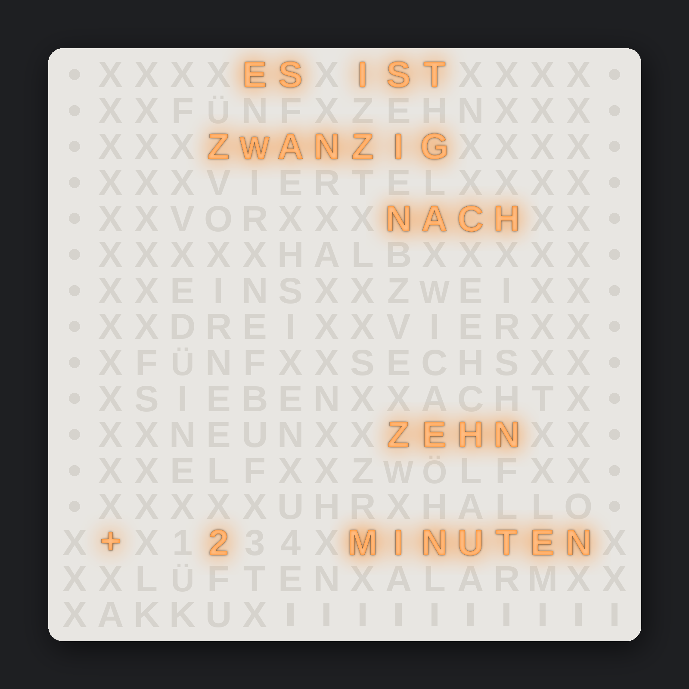
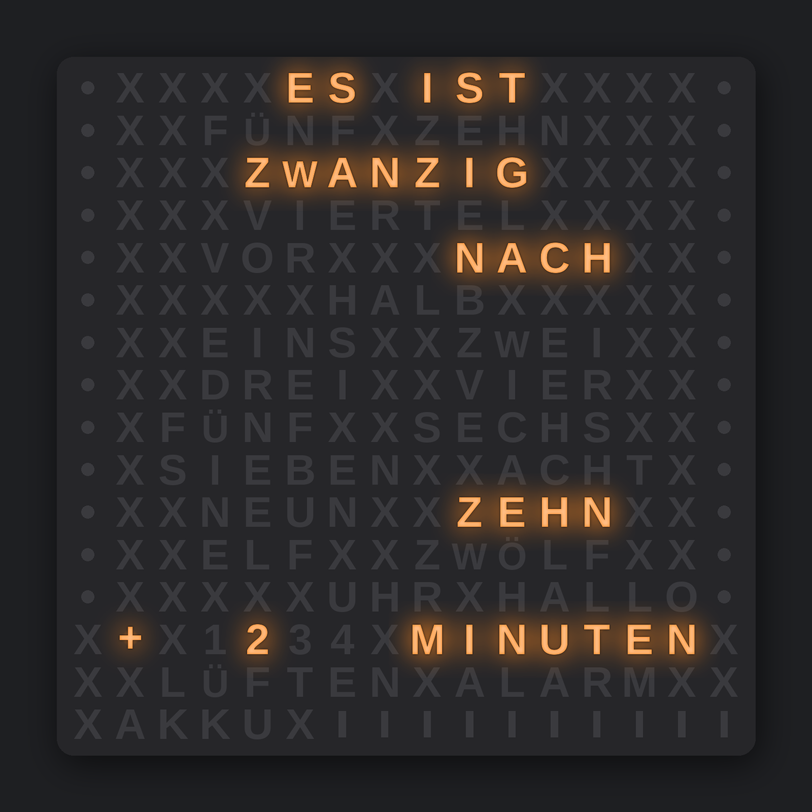
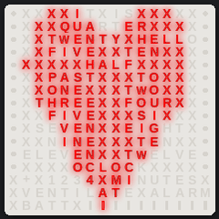
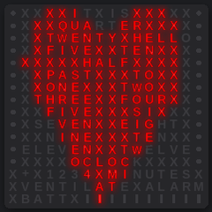
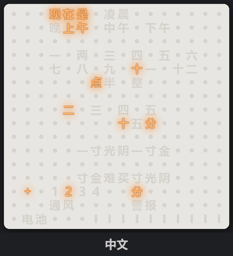
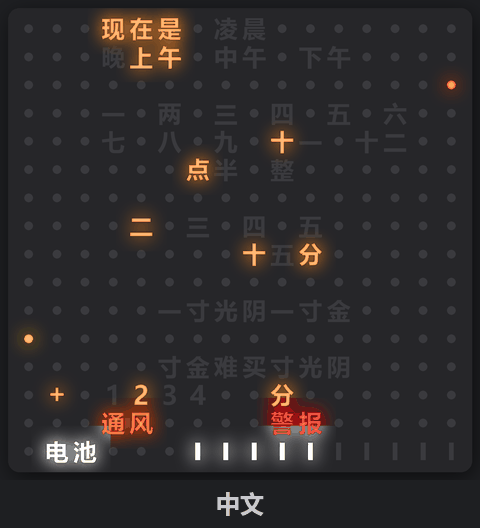

# Wordclock_Multi - Wortuhr 16x16 in vielen Sprachen

Eine Wortuhr auf einer 16 x 16 LED-Matrix (WS2812, 16 x 16 cm) mit einem ESP32. Eine Codebasis für 31 Sprachen
und Dialekte: Logik, Effekte und Gehäuse gibt es nur einmal, jede Sprache besteht aus drei kleinen Dateien.
Läuft entweder mit **ESPHome / Home Assistant** oder eigenständig als **Arduino**-Sketch mit eigener Weboberfläche.

English version: [README.md](README.md)

<p align="center">
  
  
</p>

3D-Modell (Gehäuse, Front je Sprache, Ständer, Wand- und Skadis-Halter, Bilderrahmen-Version):
**MakerWorld:** _Link folgt_ <!-- MAKERWORLD_LINK -->
Die Modelle sind nicht Teil dieses Repositorys.

Version 1.0. Modell, Druck und Firmware sind für alle Sprachen getestet. Grammatik und Schreibweise bestätigt (v1.0):
DE (Deutsch), GB (English) und die Dialekte dialect_BAD (Badisch), dialect_CH (Schwizerdütsch) und dialect_SWG (Schwäbisch).
Alle anderen Sprachen sind v0.9 (Grammatik unbestätigt), bis Muttersprachler Grammatik und Schreibweise bestätigt haben. Korrekturen sind sehr willkommen (Issue oder Pull Request).

## Funktionen

- Uhrzeit in Worten mit Einzelminuten (`+ 1..4 MINUTEN`), Farben je Anzeige (Palette, Zufall jede Stunde,
  eigene Farbe; Uhrzeit-Wörter auch „Pride“: jedes Wort eine zufällige Farbe, neu jede Minute)
- Temperaturpunkte außen (linke Spalte) und innen (rechte Spalte), Wörter LÜFTEN und ALARM, Akkubalken – jeweils
  über die Farbwahl „Aus“ abschaltbar
- Helligkeit Tag/Nacht, Nacht nach Sonnenstand, festen Zeiten oder gemischt (Sonne, aber nicht vor / nicht nach
  einer Uhrzeit)
- Effekte: Rainbow, Aurora, Matrix, Feuer, Konfetti, Sternenhimmel, Blinken (Dauer und Blinkzyklus einstellbar)
- Lauftext: ein Text läuft Buchstabe für Buchstabe über die ganze Matrix (lateinisch, griechisch, kyrillisch,
  Ziffern, € und ♥)
- Easter Egg je Sprache (Gruß oder typischer Spruch aus freien Feldern), schaltbar; wird beim Start angezeigt, bis
  die Uhrzeit bekannt ist (pulsiert blau, solange der Hotspot offen ist)
- Strombegrenzung, LED-Verdrahtung (Zickzack / zeilenweise, gespiegelt) einstellbar
- Arduino: Weboberfläche in der Sprache der Uhr (umschaltbar auf Englisch), Hotspot mit Captive Portal beim ersten Start, NTP per DHCP,
  Außentemperatur von Open-Meteo (optional), HTTP-API
- ESPHome: alle Einstellungen als Home-Assistant-Entitäten, Sensoren aus Home Assistant per Entitäts-ID

<p align="center"> </p>

## Sprachen

Reihenfolge: Landessprachen, Dialekte, andere Sprachen. Raster, Grammatik und Beispielzeiten jeder Sprache:
`docs/languages/LANG_<Code>.txt`, Übersicht `docs/languages/LANGUAGES.txt`. Neue Sprache: [LANG_SPEC.md](docs/LANG_SPEC.md).

<!-- LANGUAGES BEGIN (Tabelle von tools/make_info.py geschrieben) -->
| Code | Sprache | Art | Version | Standard-Standort |
|---|---|---|---|---|
| `DE` | Deutsch | Land | v1.0 bestätigt | Berlin |
| `GB` | English | Land | v1.0 bestätigt | London |
| `CN` | 中文 | Land | v0.9 Grammatik unbestätigt | Beijing |
| `CZ` | Čeština | Land | v0.9 Grammatik unbestätigt | Praha |
| `DK` | Dansk | Land | v0.9 Grammatik unbestätigt | København |
| `ES` | Español | Land | v0.9 Grammatik unbestätigt | Madrid |
| `FR` | Français | Land | v0.9 Grammatik unbestätigt | Paris |
| `GR` | Ελληνικά | Land | v0.9 Grammatik unbestätigt | Athína |
| `HU` | Magyar | Land | v0.9 Grammatik unbestätigt | Budapest |
| `ID` | Bahasa Indonesia | Land | v0.9 Grammatik unbestätigt | Jakarta |
| `IT` | Italiano | Land | v0.9 Grammatik unbestätigt | Roma |
| `JP` | 日本語 | Land | v0.9 Grammatik unbestätigt | Tokyo |
| `KR` | 한국어 | Land | v0.9 Grammatik unbestätigt | Seoul |
| `NL` | Nederlands | Land | v0.9 Grammatik unbestätigt | Amsterdam |
| `NO` | Norsk | Land | v0.9 Grammatik unbestätigt | Oslo |
| `PL` | Polski | Land | v0.9 Grammatik unbestätigt | Warszawa |
| `PT` | Português | Land | v0.9 Grammatik unbestätigt | Lisboa |
| `RO` | Română | Land | v0.9 Grammatik unbestätigt | București |
| `SE` | Svenska | Land | v0.9 Grammatik unbestätigt | Stockholm |
| `TR` | Türkçe | Land | v0.9 Grammatik unbestätigt | Ankara |
| `TZ` | Kiswahili | Land | v0.9 Grammatik unbestätigt | Dodoma |
| `UA` | Українська | Land | v0.9 Grammatik unbestätigt | Київ (Kyiv) |
| `dialect_BAD` | Badisch | Dialekt | v1.0 bestätigt | Freiburg im Breisgau |
| `dialect_CH` | Schwizerdütsch | Dialekt | v1.0 bestätigt | Bern |
| `dialect_SWG` | Schwäbisch | Dialekt | v1.0 bestätigt | Stuttgart |
| `EO` | Esperanto | andere | v0.9 Grammatik unbestätigt | Warszawa |
| `VA` | Latina | andere | v0.9 Grammatik unbestätigt | Città del Vaticano |
| `scifi_HVA` | Valyrio | andere | v0.9 Grammatik unbestätigt | Roma |
| `scifi_NAV` | Na'vi | andere | v0.9 Grammatik unbestätigt | Berlin |
| `scifi_QYA` | Quenya | andere | v0.9 Grammatik unbestätigt | London |
| `scifi_TLH` | tlhIngan Hol | andere | v0.9 Grammatik unbestätigt | Berlin |
| `scifi_RUNE_DE` | Runen (Deutsch) | Schrift-Variante von `DE` (nur Front) | Firmware von `DE` | Berlin |
| `scifi_RUNE_GB` | Runes (English) | Schrift-Variante von `GB` (nur Front) | Firmware von `GB` | London |
<!-- LANGUAGES END -->

<p align="center"> </p>

## Schnellstart

| Variante | Kopieren | Sprache wählen | Anleitung |
|---|---|---|---|
| Arduino | Ordner `arduino/Wordclock` ins Sketchbook | `config.h`: `#define WC_LANG_FILE "src/wc_lang_DE.h"` | [`arduino/README_DE.md`](arduino/README_DE.md) |
| ESPHome | Inhalt von `esphome/` nach `/config/esphome/` | `wordclock_multi.yaml`: `lang: !include wordclock_multi/lang/lang_DE.yaml` | [`esphome/README_DE.md`](esphome/README_DE.md) |

Beide Basisdateien enthalten alle Sprachen als fertige Zeilen im Kommentar.
Noch einfacher: Einzeldatei-Versionen je Sprache in `arduino/single_Language/` und `esphome/single_Language/`
(je Ordner eine README.md).

### ESPHome

Secrets in `secrets.yaml`: `wifi_ssid`, `wifi_password`, `ap_password`, `api_key`, `ota_password`.
Inhalt von `esphome/` 1:1 nach `/config/esphome/` kopieren (`wordclock_multi.yaml` und den Ordner `wordclock_multi/`;
der Unterordner hält die Pakete aus der Geräteliste des Dashboards heraus; `single_Language/` wird nicht gebraucht). In `wordclock_multi.yaml` Sprache,
Datenpin und die Home-Assistant-Entitäten für Alarm, Lüften, Akku und die beiden Temperaturen eintragen.
Standard: Wemos D1 mini ESP32, GPIO32, Zickzack-Verdrahtung; ESP32-C6 siehe Kommentar am Ende der Datei.
Gerätename: `name` / `friendly_name` unter `substitutions:` in `wordclock_multi.yaml`. Mehrere Uhren: je Uhr eine Kopie
von `wordclock_multi.yaml` (z. B. `wortuhr-kueche.yaml`) mit eigenem `name`, alle nutzen `wordclock_multi/`;
Umbenennen im ESPHome-Dashboard (Rename) funktioniert ebenfalls.

- Effekte: „Effekt“ und „Effekt Farbe“ wählen, dann „Effekt starten“.
- Lauftext: Textfeld „Lauftext“ und Taste „Lauftext starten“, oder in einer Automation die Aktion
  `esphome.<name>_show_text` mit `text: "Alles Gute"`.

### Arduino

ESP32-Boardpaket 2.0.x oder 3.x von Espressif (bei 2.0.x zusätzlich „Adafruit NeoPixel“). `arduino/Wordclock`
öffnen, Sprache in `config.h` wählen, per USB hochladen (Partition Scheme
„Default 4MB with spiffs“; kein Firmware-Update über WLAN). Erster Start: die Uhr öffnet einen Hotspot (z. B. „Wortuhr“),
verbinden, http://192.168.4.1 öffnen, WLAN eintragen. Danach ist die Uhr unter http://wortuhr.local (Name je
Sprache) oder ihrer IP-Adresse erreichbar.

HTTP-API (Parameternamen in allen Sprachen gleich, vollständige Liste oben in `Wordclock.ino`):

```
/api/set?tout=8.5&tin=21.5&akku=80&luft=1&alarm=0      Messwerte
/api/set?brday=40&col_time=random&show_minutes=1       Einstellungen (gespeichert)
/api/set?fx=blink&fxcolor=ff8800&fxdur=20              Effekt
/api/set?text=Alles%20Gute&textcolor=rainbow           Lauftext
/api/get                                               alle steuerbaren Werte
```

## Repository

```
arduino/Wordclock/
  Wordclock.ino            Arduino-Variante (Weboberfläche, HTTP-API, kein Home Assistant nötig)
  config.h                 <- Sprache und Hardware (Liste aller Sprachen im Kommentar)
  webpage.html             Weboberfläche (Quelle), alle Texte kommen aus der Sprachdatei
  webpage.h                dieselbe, gzip-gepackt (erzeugt von tools/make_webpage.py)
  wc_ui_en.h               englische Weboberfläche als Alternative in jeder Sprache (Texte aus wc_lang_GB.h)
  src/wc_core.h            gemeinsamer Kern: Uhrzeitanzeige, Farben, Strombegrenzung, LED-Zuordnung
  src/wc_effects.h         Effekte
  src/wc_text.h            Lauftext, src/wc_font16.h dessen 16x16-Schrift (tools/make_font.py)
  src/wc_lang_XX.h         Sprache: Raster, Wortpositionen, Uhrzeit-Grammatik, Webtexte, Standardwerte
esphome/
  wordclock_multi.yaml     <- Sprache, Board, Pins, WLAN/API/OTA, Home-Assistant-Entitäten
  wordclock_multi/core.yaml          Logik und Entitäten, für alle Sprachen gleich
  wordclock_multi/lang/lang_XX.yaml  Sprache: Gerätename, Hotspot, Standort, Entitätsnamen
  wordclock_multi/src/*.h  Kopie von arduino/Wordclock/src (tools/sync_src.py)
models/lang/lang_XX.scad   Raster jeder Sprache für die 3D-Modelle (die Modelle selbst: MakerWorld)
docs/languages/            erzeugt von tools/make_info.py: je Sprache eine Datei + Übersicht LANGUAGES.txt
docs/setup/                erzeugt von tools/make_info.py: Anleitungen FreeCAD + OpenSCAD (SETUP_*_DE/EN.md)
arduino/README*.md, esphome/README*.md  erzeugt von tools/make_info.py: Anleitungen (EN / DE)
arduino/single_Language/   Einzeldatei-Sketch je Sprache (tools/bundle_firmware.py)
esphome/single_Language/   ESPHome-Einzeldatei-Version je Sprache: .yaml + .h (tools/bundle_firmware.py)
docs/render/               Vorschaubilder, animiertes GIF aller Fronten und Lauftext-GIF, helle Front (tools/render_fronts.py);
                           *_full = zusätzlich LÜFTEN, ALARM, Akku und Temperaturpunkte in den Standardfarben
docs/render_dark/          dasselbe mit dunkler Front
docs/LANG_SPEC.md          neue Sprache anlegen
tools/                     Python-Werkzeuge (check_lang, make_info, render_fronts, bundle_firmware, ...)
  wordclock_tools.bat      Windows-Menü für alle Werkzeuge (Doppelklick, Nummer wählen, A = alle nacheinander):
                           Sprachen / ESPHome / Modelle prüfen, Fronten rendern, Firmware bündeln,
                           Fronten und Teile exportieren (binäre STL), Bambu-Studio-3MF je Sprache, Punkt P =
                           PictureFrame für einen anderen Bilderrahmen (fragt Größe, Tiefe, ... ab); erzeugte Dateien
                           werden nur bei geändertem Inhalt neu geschrieben; Logs in tools/logs/,
                           danach räumt tools/clean.py Caches und Temp-Dateien auf; Punkt B = Backup-Aufräumen
                           (entfernt auch erzeugte STL/3MF/Zips/Schriften, nur von git ignorierte Ausgaben, fragt vorher);
                           unveränderte Ausgaben werden übersprungen (Punkte 5, 9, 10, 12-14, 16), "A" nach einer
                           Änderung baut also nur neu, was sich wirklich geändert hat; alles neu: `wordclock_tools.bat A F`
  wc_stamp.py              Basisdaten jeder Ausgabe (Inhalts-Hash und Datum der Eingangsdateien, Parameter, Versionen
                           von OpenSCAD, Schriften) in einer Info-Datei neben den Ausgaben:
                           docs/render*/render_info.json,
                           _private/makerworld/export/export_info.json, export_3mf/3mf_info.json; --force = alles neu
  install_fonts.py         prüft die Schriften der Fronten (CN, JP, KR: Noto Sans SC/JP/KR Bold, Runen: Segoe UI
                           Historic), lädt fehlende Noto-Schriften und installiert sie für alle Benutzer (Menüpunkt 15)
  make_3mf.py              Bambu-Studio-Projekt (3MF) je Sprache (oder eins mit allen Fronten) aus tools/template_P2S.3mf:
                           nur die Netze werden getauscht, Drucker, Profil, Farbwechsel, Platten und Objekt-Einstellungen
                           kommen aus der Vorlage; abbrechbare Haken-Stützen als entfernbares Teil;
                           --pictureframe (Menüpunkt 16): ein Projekt je Sprache und Bilderrahmen
                           (Wordclock_Pictureframe_<RIBBA|SANNAHED>_<LANG>_<Schrift>.3mf), die Platte übernimmt Platz
                           und Einstellungen der Front derselben Vorlage
  export_fronts.py         STL-Export mit OpenSCAD: Fronten, Teile, PictureFrame-Platten je Rahmen
                           (PF_FRAMES: RIBBA 231 / 38 mm, SANNAHED 249 / 44 mm -> Pictureframe_<RAHMEN>_<LANG>_<Schrift>.stl)
```

Die C++-Dateien in `arduino/Wordclock/src/` nutzen beide Varianten (ESPHome über `esphome: includes:`). Sie werden
nur dort geändert, `python3 tools/sync_src.py` kopiert sie in den ESPHome-Ordner.

Werkzeuge (Python 3, g++ für die Vorschauen):

g++ unter Windows (MinGW-w64 von WinLibs): in der Eingabeaufforderung `winget install BrechtSanders.WinLibs.POSIX.UCRT`,
danach ein neues Fenster öffnen und mit `g++ --version` prüfen. Ohne g++ prüft `tools/wordclock_tools.bat` (Punkt 1) Raster, Texte und
YAML, aber nicht die Füllfelder, und die Dateien `docs/languages/LANG_XX.txt` werden nicht neu geschrieben. Wird `g++` nicht
gefunden, den `bin`-Ordner von WinLibs in `Path` eintragen (Windows-Taste, „Umgebungsvariablen“, Umgebungsvariablen
für dieses Konto bearbeiten).

```
python3 tools/check_lang.py [XX] [--words]   Raster, Wortpositionen, Texte, YAML-Schlüssel prüfen
python3 tools/make_info.py                   docs/languages, Anleitungen, Sprachlisten in config.h, YAML und README schreiben
python3 tools/render_fronts.py [XX ...]      PNG-Bilder der Fronten plus GIF (Pillow), z. B. --style dark --time 13:47
                                             (Satz normal und _full, nur einer: --set normal / --set full)
                                             (Windows: tools/wordclock_tools.bat, Punkt 5; kein Compiler nötig, die
                                             leuchtenden Wörter kommen aus tools/render_masks.json.xz)
python3 tools/make_masks.py                  diesen Masken-Cache nach Sprachänderungen neu bauen (braucht g++)
python3 tools/make_font.py                   Lauftext-Schrift src/wc_font16.h neu erzeugen (Pillow)
python3 tools/make_webpage.py                webpage.html nach webpage.h packen (nach jeder Änderung der Seite)
python3 tools/bundle_firmware.py [XX ...]    Einzeldatei-Versionen in arduino/ und esphome/single_Language
python3 tools/clean.py [--dry] [--backup]    __pycache__, temporäre Build-Ordner und andere Reste entfernen;
                                             --backup auch erzeugte STL/3MF/Zips/Schriften (schlankes Backup)
```

## Hardware

- LED-Matrix 16 x 16 WS2812 (16 x 16 cm, 10 mm Raster), LED 0 vorne oben rechts (`mirror_x`), Zickzack-Verdrahtung
  (`serpentine`, einstellbar)
- ESP32: Wemos D1 mini ESP32 (Standard, GPIO32), ESP32-C6 SuperMini oder XIAO ESP32C6 (GPIO2)
- 5-V-Netzteil (Strombegrenzung in der Software, Standard 500 mA), Pegelwandler 74AHCT125 empfohlen

## Füllfelder

Felder, die nie leuchten, sind in jedem Raster `x`. Die Modelle drucken sie als X, als Punkt (CN, JP, KR) oder als
beliebiges anderes Zeichen; sie bleiben offene Lichtkammern, damit Effekte und Lauftext die ganze Fläche nutzen.

## Lizenz

[CC BY-NC-SA 4.0](LICENSE): frei nutzen, ändern und weitergeben für nicht-kommerzielle Zwecke, mit Namensnennung
(design butchooka, https://github.com/butchooka/Wordclock_Multi) und unter gleicher Lizenz.
Die Lauftext-Schrift ist abgeleitet von DejaVu Sans Condensed Bold (freie Lizenz, https://dejavu-fonts.github.io/).
